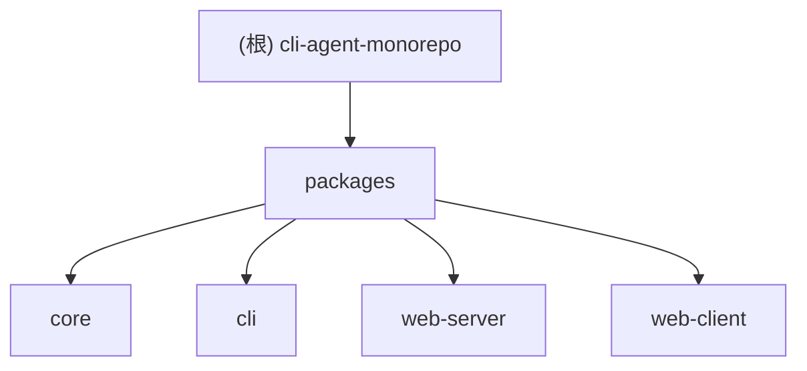

# DevAgent.md — cli-agent-monorepo

> **变更记录 (Changelog)**
> - 2026-09-16：初始创建，全量扫描 51 个文件，覆盖率 100%
> - 2026-09-16：代理机制重构 — 改用 `setGlobalDispatcher` 全局代理，移除 openai-provider 和 web-tools 中的独立 undici fetch/ProxyAgent 逻辑
> - 2026-09-17：undici 迁移 — 将 `proxy.ts` 及其 undici 依赖从 `@agent/core` 移到 `@agent/cli`，core 不再依赖 undici
> - 2026-09-18：web-client 交互增强 — 发送消息/切换会话自动滚动到底部；删除单条成对消息（`POST /api/conversations/:id/messages/delete`）；模型选择器固定宽度 + hover 提示；复制单条消息
> - 2026-09-18：多提供商配置与密钥环境变量化 — LLM 配置改为 provider 嵌套 map（参照 opencode 风格），apiKey 移入 `.env`（按 `{ID}_API_KEY` 读取，ID 特殊字符规范化为下划线），baseUrl 优先 `options.baseURL` 回退 env `{ID}_BASE_URL`；所有提供商统一 OpenAI 兼容实现；前端模型选择器以「提供商显示名/模型显示名」扁平展示
> - 2026-09-18：baseUrl 支持 `{model}` 占位符 — 同一提供商下不同模型可指向不同端点（按模型 ID 展开模板）；deepseek-flash/pro/qwen 合并为 `openllm` 提供商
> - 2026-09-20：子 Agent 方案 A — `agent.ts` 重构出公共 `runTask`（独立会话执行工具循环，不污染主会话，支持 `maxRounds`/`systemPrompt`/`allowedTools`）；新增 `tools/subagent-tool.ts` 的 `createSubAgentTool` 工厂，将子 Agent 包装为普通 Tool，默认只读工具白名单，结果 JSON 化返回并截断
> - 2026-09-20：多 Agent 声明式配置 — `agent.config.json` 增加 `subagents` 数组，CLI 启动时自动为每个条目注册 `run_subagent_<name>` 工具（`cli/src/index.ts` 的 `registerSubAgents`），复用父 agent + `runTask.allowedTools` 收窄工具集；清理 core/dist 历史 `subagent/` 残留（含 `resolveSubAgentConfig` 陈旧引用）

---

## 项目愿景

**CLI Agent** 是一个基于 Node.js + TypeScript 的 **npm workspaces monorepo** 项目，旨在构建一个支持 **tool-calling（工具调用）** 的智能 CLI 助手。用户可通过命令行 REPL 或 Web 聊天界面与 LLM 交互，Agent 能自动调用文件读写、Shell 命令、Web 抓取等工具完成复杂任务。

---

## 架构总览

```
用户输入 → CLI (REPL) / Web Client (React)
                ↓
         Web Server (Koa + SSE)  ←→  AgentSDK (核心引擎)
                ↓                       ↓
         ProviderManager          ToolRegistry
         (多模型切换)              (工具注册/执行)
                ↓                       ↓
         OpenAIProvider           file/shell/web tools
         (LLM 调用)               (Node.js 原生能力)
                ↓
         SessionStore (文件持久化)
```

---

## 模块结构图



---

## 模块索引

| 模块 | 路径 | 语言 | 职责 |
|------|------|------|------|
| `@agent/core` | `packages/core` | TypeScript | 核心引擎：会话管理、LLM 抽象、工具系统、存储 |
| `@agent/cli` | `packages/cli` | TypeScript | CLI 入口：命令行参数解析、REPL 交互循环 |
| `@agent/web-server` | `packages/web-server` | TypeScript (Koa) | Web 服务：REST API + SSE 流式推送 |
| `@agent/web-client` | `packages/web-client` | TypeScript + React | Web 前端：DeepSeek 风格聊天界面 |

---

## 运行与开发

### 环境要求
- Node.js ≥ 22（使用 `fs.glob`、`crypto.randomUUID` 等新 API）
- pnpm ≥ 10（workspaces 支持）

### 常用命令

| 命令 | 说明 |
|------|------|
| `pnpm run dev` | 开发模式启动 CLI（使用 tsx 直接运行 TS） |
| `pnpm run build` | 构建所有子包（tsc 编译） |
| `pnpm run test` | 运行所有子包的测试 |
| `pnpm run typecheck` | 类型检查所有子包 |
| `pnpm run dev` | 启动 Web 前端开发服务器（Vite，端口 5173） |
| `pnpm --filter web-client run build` | 构建 Web 前端（Vite + Tailwind） |

### 启动方式

```bash
# 首次使用：复制密钥模板并在 .env 中填入提供商密钥（{PROVIDER_ID}_API_KEY）
cp .env.example .env

# CLI 模式（默认）
npm run dev

# CLI 模式 + Web 界面
npm run dev -- --web

# 恢复会话
npm run dev -- --resume <session-id>

# 指定配置文件
npm run dev -- --config ./my-config.json
```

### LLM 配置说明（provider 嵌套结构）

- `agent.config.json` 使用以提供商为中心的嵌套结构（参照 opencode 配置风格），**不含任何密钥**：
  ```json
  {
    "provider": {
      "deepseek": {
        "name": "DeepSeek",
        "options": { "baseURL": "http://..." },
        "models": { "deepseek-v4-pro": { "name": "deepseek-v4-pro" } }
      }
    }
  }
  ```
- 密钥放 `.env`：`{PROVIDER_ID}_API_KEY`（ID 大写，特殊字符规范化为下划线，如 `deepseek-flash` → `DEEPSEEK_FLASH_API_KEY`）。
- baseUrl 优先级：`options.baseURL` → `.env` 的 `{PROVIDER_ID}_BASE_URL` → OpenAI 默认地址；三者均支持 `{model}` 占位符，解析时替换为模型 ID（同一提供商的多个模型可指向不同端点）。
- 所有提供商统一走 OpenAI 兼容接口；`ProviderManager` 以「提供商显示名/模型显示名」展示与切换模型。

---

## 编码规范

- **TypeScript strict 模式**：`tsconfig.base.json` 启用 `strict`、`noUnusedLocals`、`noUnusedParameters`、`noImplicitReturns`
- **ESM 模块**：所有包使用 `"type": "module"`
- **路径别名**：开发模式下 `@agent/core` → `packages/core/src/index.ts`，`@agent/web-server` → `packages/web-server/src/index.ts`
- **错误处理**：所有领域错误继承 `AgentError` 基类
- **代理支持**：`@agent/cli` 的 `proxy.ts` 自动读取 `HTTPS_PROXY`/`HTTP_PROXY`/`http_proxy` 环境变量，通过 undici `setGlobalDispatcher` 设置全局代理（cli 启动时调用）

---

## 代码地图维护规则

> **重要**：每次对项目代码进行修改后，必须同步更新 `.devagent/specs/` 下对应模块的文档以及本 `DevAgent.md`，确保代码地图始终与代码库保持一致。

---

## AI 使用指引

- **工作区限制**：所有操作仅限 `当前工作` 目录
- **系统提示词**：`system_prompt.md` 定义了角色定位、安全约束和交流规范
- **配置文件**：`agent.config.json` 包含 LLM 供应商配置（多模型）、存储路径、工具启用列表
